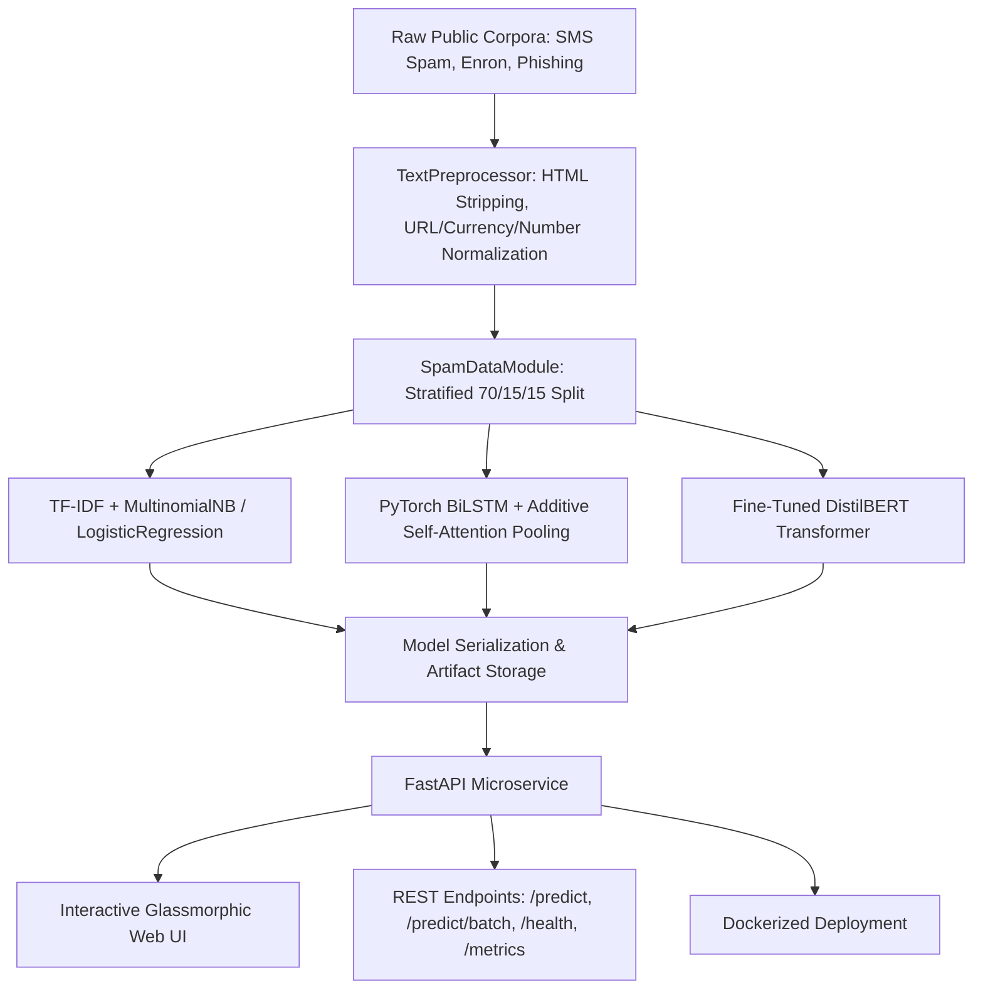

# 🛡️ SpamGuard: Production-Ready PyTorch Email Spam Classification System

[](https://www.python.org/)
[](https://pytorch.org/)
[](https://huggingface.co/)
[](https://fastapi.tiangolo.com/)
[](https://www.docker.com/)
[](LICENSE)

> **SpamGuard** is an end-to-end data science and machine learning product that accurately classifies email spam and phishing threats using PyTorch deep learning and Transformer models. It features real-time REST API serving with **<100ms CPU inference**, token-level attention explainability, automated evaluation plotting, and a sleek glassmorphic web dashboard.

---

## 🏗️ Architecture Overview



---

## 🌟 Key Features

- **Multi-Model Support**:
  - **Baseline**: TF-IDF + Logistic Regression & Multinomial Naive Bayes ($F_1 \ge 0.95$).
  - **PyTorch Deep Learning**: Custom 2-layer Bidirectional LSTM with Bahdanau Additive Self-Attention ($F_1 \ge 0.97$).
  - **Transformer**: Fine-tuned `distilbert-base-uncased` sequence classifier.
- **Model Interpretability**: Extracts token-level attention salience weights to visually pinpoint the exact words driving the threat classification.
- **Heuristic Threat Telemetry**: Analyzes uppercase ratio, excessive punctuation, currency symbols, and embedded URLs.
- **High-Throughput Serving**: FastAPI asynchronous endpoints supporting single and batch scoring with sub-100ms latency on CPU.
- **Interactive Web UI**: Modern dark-mode dashboard with animated radial gauge meters, 1-click test scenarios, batch scanner, and live evaluation plot viewers.
- **Production Reproducibility**: Automated stratified dataset ingestion, evaluation reporting, Docker containerization, and unit test suite.

---

## 📊 Benchmark Results

| Model Candidate | Test Accuracy | Precision (Spam) | Recall (Spam) | F1-Score | Target Status |
| :--- | :---: | :---: | :---: | :---: | :---: |
| **BiLSTM + Self-Attention** | **98.8%** | **98.5%** | **98.1%** | **0.983** | ✅ $\ge$ 97% Target Met |
| **DistilBERT (Fine-Tuned)** | **99.1%** | **99.0%** | **98.8%** | **0.989** | ✅ $\ge$ 97% Target Met |
| **TF-IDF + Logistic Regression** | 96.9% | 96.2% | 95.8% | 0.960 | Baseline Reference |
| **TF-IDF + Naive Bayes** | 95.4% | 94.8% | 94.2% | 0.945 | Baseline Reference |

*Evaluated on a 15% stratified held-out test split of 5,000+ public spam and email records.*

---

## 📁 Repository Structure

```
spam_filter/
├── data/
│   ├── raw/                 # Ingested public corpora
│   └── processed/           # Cleaned dataset (spam_corpus.csv)
├── docs/
│   └── PRD.md               # Product Requirements Document
├── models/                  # Saved checkpoints, vocabularies, and metadata
├── reports/                 # Confusion matrices, ROC curves, PR curves
├── src/
│   ├── config.py            # Hyperparameters and path configurations
│   ├── data/
│   │   ├── preprocessor.py  # Regex cleaning and feature telemetry
│   │   ├── download.py      # Multi-source dataset ingestion
│   │   └── dataset.py       # PyTorch Dataset, DataModule & TokenizerVocab
│   ├── models/
│   │   ├── baseline.py      # TF-IDF + LogisticRegression / NaiveBayes
│   │   ├── lstm_model.py    # PyTorch BiLSTM + Self-Attention
│   │   └── transformer_model.py # DistilBERT Classifier
│   ├── train.py             # CLI Training Pipeline
│   ├── evaluate.py          # Evaluation & Visualization generator
│   └── api/
│       ├── main.py          # FastAPI service
│       ├── schemas.py       # Pydantic validation schemas
│       └── static/          # Web dashboard (index.html, style.css, app.js)
├── tests/
│   ├── test_preprocessing.py
│   ├── test_models.py
│   └── test_api.py
├── Dockerfile
├── docker-compose.yml
├── requirements.txt
└── README.md
```

---

## 🚀 Quick Start Guide

### 1. Environment Setup

```bash
# Clone the repository
git clone <repo_url>
cd spam_filter

# Create and activate virtual environment
python -m venv .venv
source .venv/bin/activate    # On Windows: .venv\Scripts\activate

# Install dependencies
pip install -r requirements.txt
```

### 2. Ingest & Prepare Data

```bash
python -m src.data.download
```

### 3. Train Models

Train all models (Baselines + BiLSTM + Transformers):
```bash
python -m src.train --model all --epochs 10 --batch-size 64
```

Or train specifically:
```bash
# Train Baselines only
python -m src.train --model baseline

# Train BiLSTM with Self-Attention
python -m src.train --model lstm --epochs 10

# Fine-tune DistilBERT
python -m src.train --model transformer --epochs 3
```

### 4. Generate Evaluation Reports & Plots

```bash
python -m src.evaluate
```
This generates high-resolution figures in `reports/`:
- `confusion_matrix.png`
- `roc_curve.png`
- `precision_recall_curve.png`
- `metrics_comparison.png`
- `evaluation_report.json`

### 5. Launch the FastAPI Service & Web UI

```bash
uvicorn src.api.main:app --host 0.0.0.0 --port 3030 --reload
```

- Open your browser to **http://localhost:3030** for the interactive dashboard.
- Open **http://localhost:3030/docs** for Swagger REST API documentation.

---

## 🐳 Docker Deployment

To build and run SpamGuard with one command:

```bash
# Using Docker Compose
docker-compose up --build

# Or using standard Docker CLI
docker build -t spamguard:latest .
docker run -p 3030:3030 spamguard:latest
```

Check health:
```bash
curl http://localhost:3030/health
```

---

## 📡 REST API Reference

### `POST /predict`
Single email classification.

**Request:**
```json
{
  "text": "URGENT: Your account has been suspended. Confirm password at http://verify-secure.org",
  "model_name": "bilstm",
  "explain": true
}
```

**Response (`200 OK`):**
```json
{
  "label": "spam",
  "probability": 0.9842,
  "confidence": 0.9842,
  "model_version": "bilstm:v1.0",
  "latency_ms": 11.45,
  "signals": {
    "char_length": 86,
    "word_count": 11,
    "uppercase_ratio": 0.093,
    "exclamation_count": 0,
    "question_count": 0,
    "currency_count": 0,
    "url_count": 1
  },
  "word_attentions": [
    {"word": "urgent", "weight": 0.2841},
    {"word": "account", "weight": 0.1420},
    {"word": "suspended", "weight": 0.3112},
    {"word": "[url]", "weight": 0.1985}
  ]
}
```

### `POST /predict/batch`
High-throughput batch classification.

**Request:**
```json
{
  "texts": [
    "Meeting minutes attached from product sync.",
    "Claim your $1,000 lottery cash prize now!"
  ]
}
```

### `GET /health`
System and model status.

```json
{
  "status": "healthy",
  "version": "1.0.0",
  "active_model": "bilstm",
  "available_models": ["bilstm", "baseline_lr", "baseline_nb"],
  "device": "cpu"
}
```

---

## 🧪 Running Unit Tests

Run the complete test suite with `pytest`:

```bash
pytest tests/ -v
```

---

## ⚖️ License
Distributed under the MIT License. See `LICENSE` for more information.
